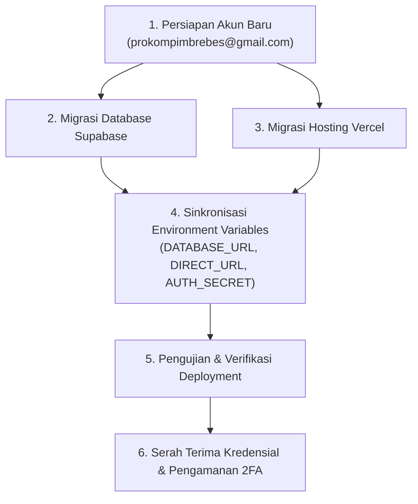

# Rencana Kerja: Migrasi Akun Vercel & Supabase ke Prokompim Brebes

Dokumen ini memuat panduan langkah demi langkah untuk memindahkan infrastruktur hosting (**Vercel**) dan basis data (**Supabase**) dari akun pengembang pribadi ke akun resmi kedinasan Bagian Prokompim Setda Kabupaten Brebes.

---

## 📌 Informasi Akun Resmi Baru

| Layanan | Akun / Email | Catatan |
|---------|--------------|---------|
| **Google Workspace / Gmail** | `prokompimbrebes@gmail.com` | Email utama instansi untuk menerima notifikasi, token, dan verifikasi |
| **Kredensial Awal** | `prokompimbrebes2026,` | *Wajib diamankan dan aktifkan 2-Factor Authentication (2FA)* |
| **Vercel** | Terdaftar via `prokompimbrebes@gmail.com` | Hosting Frontend & Serverless Next.js 15 |
| **Supabase** | Terdaftar via `prokompimbrebes@gmail.com` | Managed PostgreSQL Database & Storage |

---

## 🗺️ Tahapan Eksekusi Migrasi



---

## 📋 Detail Langkah-Langkah

### Tahap 1: Registrasi Akun Baru

1. **Email Kedinasan**:
   - Pastikan email `prokompimbrebes@gmail.com` dapat diakses dan menerima email masuk.
2. **Registrasi Supabase**:
   - Buka [supabase.com](https://supabase.com) ➔ Klik **Sign In** ➔ **Sign Up**.
   - Daftar menggunakan email `prokompimbrebes@gmail.com`.
   - Konfirmasi tautan verifikasi yang dikirimkan ke Gmail.
3. **Registrasi Vercel**:
   - Buka [vercel.com](https://vercel.com) ➔ Klik **Sign Up**.
   - Daftar menggunakan email `prokompimbrebes@gmail.com` (atau via GitHub akun kedinasan jika ada).
   - Konfirmasi tautan verifikasi.

---

### Tahap 2: Migrasi Supabase (Pilih Salah Satu Metode)

#### 🌟 Metode A: Transfer Project Langsung (Rekomendasi - Tanpa Downtime & Paling Cepat)
1. Login ke **akun Supabase lama (pribadi)**.
2. Buka dashboard project database SIAP-PRO.
3. Masuk ke menu **Project Settings** ➔ **General**.
4. Scroll ke bagian **Transfer Project**.
5. Pilih **Transfer to another user/organization** dan masukkan email `prokompimbrebes@gmail.com`.
6. Login ke **akun Supabase baru (`prokompimbrebes@gmail.com`)**, buka undangan/notifikasi transfer lalu konfirmasi persetujuan (*Accept*).
7. **Hasil**: Database, data kegiatan, dokumen, user, dan connection string tetap sama tanpa perlu migrasi manual atau ubah env URL.

#### 🔄 Metode B: Ekspor - Impor ke Project Baru (Jika Membuka Database Baru)
1. Di akun Supabase baru, buat **New Project** (misal: `siap-pro-brebes`, Region: Singapore `ap-southeast-1`).
2. Catat dan simpan **Database Password**.
3. Backup database dari akun lama:
   - Via Supabase Dashboard: **Database** ➔ **Backups** (Download).
   - Atau via CLI:
     ```bash
     supabase db dump -f backup_data.sql
     ```
4. Restore ke database baru di akun baru.
5. Jalankan migrasi Prisma untuk memastikan skema up-to-date:
   ```bash
   npx prisma migrate deploy
   ```
6. Salin connection string baru:
   - `DATABASE_URL`: Connection string Pooler (Transaction mode, port `6543`).
   - `DIRECT_URL`: Connection string Direct (Session mode, port `5432`).

---

### Tahap 3: Migrasi Vercel (Pilih Salah Satu Metode)

#### 🌟 Metode A: Transfer Project Vercel Langsung
1. Login ke **akun Vercel lama (pribadi)**.
2. Buka project `sistem-spj-protokom` / `siap-pro`.
3. Masuk ke tab **Settings** ➔ **General** ➔ scroll ke bagian bawah **Transfer Project**.
4. Masukkan username/email akun baru (`prokompimbrebes@gmail.com`).
5. Akun baru menerima konfirmasi transfer.
6. Semua konfigurasi domain, build settings, dan history otomatis berpindah.

#### 🔄 Metode B: Re-deploy di Akun Vercel Baru
1. Login ke **akun Vercel baru (`prokompimbrebes@gmail.com`)**.
2. Hubungkan akun Vercel dengan repositori Git (GitHub/GitLab) yang berisi source code SIAP-PRO.
3. Klik **Add New...** ➔ **Project** ➔ Import repository.
4. Framework Preset: **Next.js**.
5. Masukkan **Environment Variables**:
   - `DATABASE_URL`: Connection string Supabase.
   - `DIRECT_URL`: Connection string direct Supabase.
   - `AUTH_SECRET`: Secret key JWT aplikasi.
6. Klik **Deploy**.

---

### Tahap 4: Verifikasi & Pengujian Pasca-Migrasi

Lakukan uji fungsi sistem setelah migrasi selesai:
- [ ] **Akses Web**: Buka URL production Vercel baru.
- [ ] **Autentikasi**: Uji login menggunakan user admin (`admin@prokompim.brebeskab.go.id`).
- [ ] **Dashboard**: Pastikan kartu statistik dan grafik 12 bulan memuat data kegiatan dengan benar.
- [ ] **Worksheet**: Uji fitur tambah data kegiatan, update status, dan edit dokumen.
- [ ] **Laporan**: Uji download rekap laporan dalam format Excel (`.xlsx`) dan cetak PDF.
- [ ] **Pemberian Hak Akses Git**: Pastikan branch `main` pada repo Git tetap memicu auto-deploy ke Vercel baru saat ada pembaruan kode.

---

### Tahap 5: Keamanan & Serah Terima Akhir

1. **Aktifkan 2FA**:
   - Aktifkan Google 2-Step Verification pada `prokompimbrebes@gmail.com` menggunakan nomor ponsel kedinasan / authenticator app.
   - Aktifkan 2FA pada akun Vercel dan Supabase.
2. **Pencabutan Akses Akun Pribadi**:
   - Setelah akun baru terverifikasi penuh dan berfungsi normal, hapus project dari akun pribadi lama agar tidak terjadi duplikasi atau kerancuan billing/resource.
3. **Dokumentasi Kredensial**:
   - Simpan informasi kredensial di brankas password resmi instansi (misal: Bitwarden/KeePass) atau Berita Acara Serah Terima Sistem.
